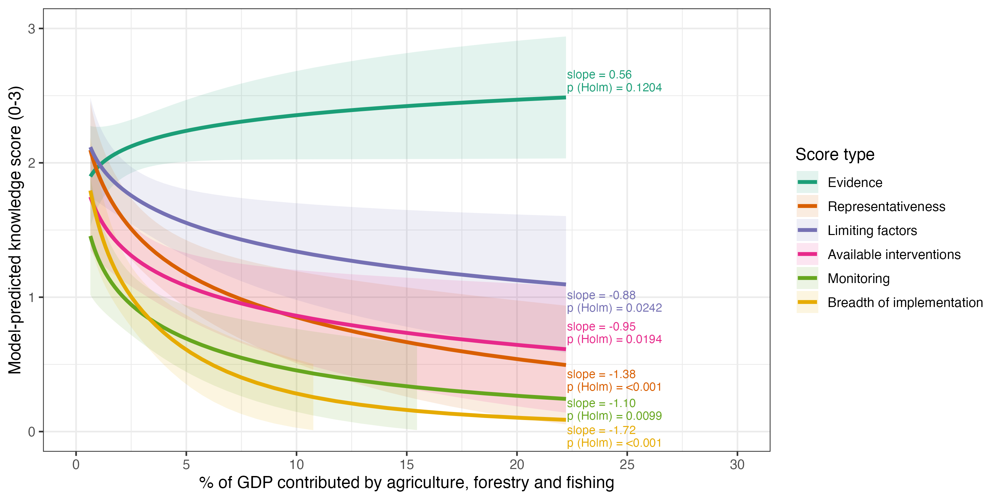
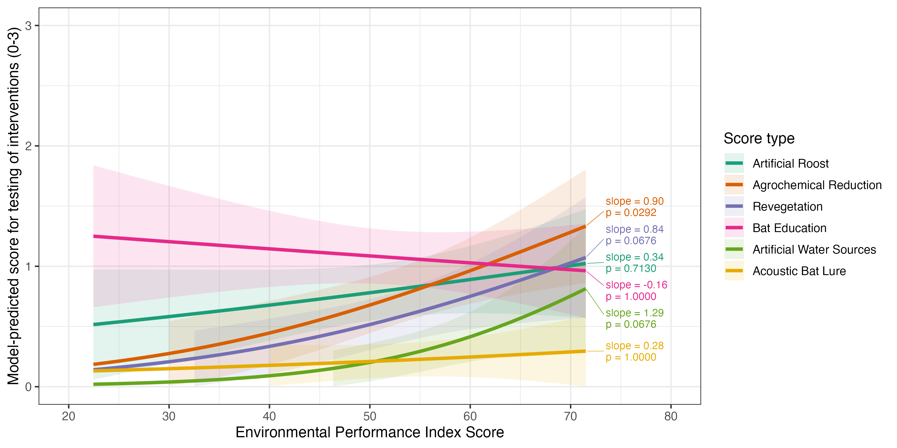

<h1 align="center">🦇 IBRC Synthesis Paper: Bats as Pest Suppressors 🦇</h1>

Our global synthesis paper summarises published and unpublished knowledge on insectivorous bats as pest suppressors in agricultural systems, and the interventions trialled to support them.

This repository contains the raw survey data from all contributors, data-wrangling scripts, cleaned datasets, and scripts for visualising and analysing the data.

---

## 📋 Overview of Data

Contributors completed two surveys about the research conducted in their study systems. A **study system** is a crop type $\times$ region combination in which studies were done.

| Survey | Focus | Purpose |
| :--- | :--- | :--- |
| **#1: Knowledge scoring** | Conceptual pathway | Places each study system within our conceptual "knowledge pathway" (**Figure 1**). Scores at each step range from 0 (no knowledge) to 3 (extensive knowledge). |
| **#2: Implementation scoring** | Interventions | Records which interventions have been implemented and tested for their effects on bats. Scores for each intervention range from 0 (not tried) to 3 (tried and evaluated). |

   
  <i>Figure 1: Conceptual knowledge pathway used to score study systems (see Script 0).</i>

---

# 🗺️ Study System Maps

* 📍 [Interactive study system map (Pin markers)](https://rani-davis.github.io/IBRC-Synthesis-Paper_bats-as-pest-suppressors/map%20exports/teardrop%20map_interactive.html)
* 🔵 [Interactive study system map (Circle markers)](https://rani-davis.github.io/IBRC-Synthesis-Paper_bats-as-pest-suppressors/map%20exports/circle%20map_interactive.html)

---

# 📊 Key Figures

## Knowledge Pathway Scores (Survey 1)

   
  <i>Figure 2: Knowledge pathway progress across crop types, showing mean scores (± SE) with raw respondent-level data points.</i>

   
  <i>Figure 3: Knowledge pathway progress across regions, showing mean scores (± SE) for each question in Survey 1 with raw respondent-level data points.</i>

## Intervention Testing Scores (Survey 2)

   
  <i>Figure 4: Proportion of study systems that have tested different bat-supportive interventions.</i>

   
  <i>Figure 5: Mean intervention testing scores (± SE) by crop type.</i>

   
  <i>Figure 6: Mean intervention testing scores (± SE) by world region.</i>

---

# 📈 Do country-level factors explain knowledge and intervention testing? (CLMMs)

We tested whether scores in each survey were associated with national socio-economic, environmental and agricultural indices (GDP, agriculture's share of GDP, public agricultural R&D, Environmental Performance Index), plus bat species richness and latitude. Because scores are ordinal (0 to 3), we fitted separate **Cumulative Link Mixed Models (CLMMs)** for each survey, with `Score.type` (the pathway step or intervention) as a fixed effect and random effects for country and respondent.

**Full methods** (predictor sources and transformations, candidate model set, and AICc ranking) are in the manuscript Methods and Supplementary Table X. Code is in `Script 10` (Survey 1) and `Script 11` (Survey 2).

### Best-supported models

| Survey | Best model | Predictor effect |
| :--- | :--- | :--- |
| Survey 1: Knowledge pathway | `Score ~ Score.type + AgGDP × Score.type + (1 \| Country) + (1 \| Respondent)` | Scores were **lower in more agriculture-dependent countries** at most steps |
| Survey 2: Intervention testing | `Score ~ Score.type + EP × Score.type + (1 \| Country) + (1 \| Respondent)` | Testing was **higher in countries with better Environmental Performance** for some interventions |

Bat species richness did not improve the Survey 1 model (ΔAICc = 1.74 on the full dataset). Slopes below are cumulative log-odds of a higher score per +1 SD of the predictor, with Holm-adjusted p-values across the six steps or interventions.

---

## Survey 1: Knowledge Pathway

   
  <i>Figure 7: CLMM-predicted relationship between the percentage of GDP contributed by agriculture, forestry and fishing and scores at each step of the knowledge pathway.</i>

Knowledge scores fell as agriculture's share of GDP increased at every step except Evidence, with the strongest declines for Representativeness and Breadth of Implementation of Interventions.

<b>Post-hoc slopes for each step</b>

| Step in knowledge pathway | Slope | SE | Lower CI | Upper CI | z | p (Holm) |
| :--- | ---: | ---: | ---: | ---: | ---: | ---: |
| Evidence | 0.56 | 0.36 | -0.39 | 1.51 | 1.55 | 0.120 |
| Representativeness | -1.38 | 0.35 | -2.31 | -0.45 | -3.93 | < 0.001 *** |
| Limiting Factors | -0.88 | 0.35 | -1.81 | 0.05 | -2.51 | 0.024 * |
| Available Interventions | -0.95 | 0.35 | -1.87 | -0.03 | -2.72 | 0.019 * |
| Monitoring Interventions | -1.10 | 0.36 | -2.06 | -0.14 | -3.03 | 0.010 ** |
| Breadth of Implementation of Interventions | -1.72 | 0.39 | -2.74 | -0.69 | -4.42 | < 0.001 *** |

---

## Survey 2: Intervention Testing

   
  <i>Figure 8: CLMM-predicted relationship between Environmental Performance Index and testing scores for each intervention.</i>

Only Agrochemical Reduction showed a clear positive association with Environmental Performance (about 2.5 times higher odds of a higher score per +1 SD). Artificial Water Sources and Revegetation had similarly large positive slopes with intervals including zero (both p = 0.068). Slopes for the remaining interventions were close to zero.

> **Caution:** The interaction model was chosen on the full dataset with modest support over the main-effects model (ΔAICc = 2.2), and model diagnostics showed significant quantile deviations. Interpret these results cautiously.

<b>Post-hoc slopes for each intervention</b>

| Intervention | Slope | SE | Lower CI | Upper CI | z | p (Holm) |
| :--- | ---: | ---: | ---: | ---: | ---: | ---: |
| Artificial Roost | 0.34 | 0.29 | -0.42 | 1.10 | 1.18 | 0.713 |
| Agrochemical Reduction | 0.90 | 0.32 | 0.06 | 1.74 | 2.82 | 0.029 * |
| Revegetation | 0.84 | 0.35 | -0.07 | 1.76 | 2.42 | 0.068 |
| Bat Education | -0.16 | 0.25 | -0.83 | 0.50 | -0.65 | 1.000 |
| Artificial Water Sources | 1.29 | 0.52 | -0.09 | 2.67 | 2.47 | 0.068 |
| Acoustic Bat Lure | 0.28 | 0.43 | -0.84 | 1.40 | 0.65 | 1.000 |

---

# 🤝 Seeking modelling expertise

If you are experienced with mixed models involving socio-economic, environmental or agricultural predictors and hierarchical structure, we would welcome input on alternative model structures.

Please contact: rani.davis@uqconnect.edu.au

Collaborators can be given access to edit the GitHub repository and explore alternative approaches.

---

# 📂 Repository Structure

* 📁 `Analysis/raw data/` — Raw survey data as submitted by contributors
* 📁 `Analysis/clean data/` — Cleaned and scored survey datasets
* 📁 `Analysis/scripts/` — Data processing, modelling, and visualisation scripts
* 📁 `Analysis/model selection/` — AICc model comparisons, diagnostics and model predictions
* 📁 `figure exports/` — Key figures produced by scripts
* 📁 `docs/map exports/` — Interactive HTML maps showing spatial coverage

# 📑 Scripts

| Script | Purpose |
| :--- | :--- |
| `Map Script` | Creates maps showing spatial coverage of study systems |
| `Colour palette Script` | Defines consistent colour palettes used across maps and figures |
| `Script 0` | Visualises the conceptual knowledge pathway |
| `Script 1` | Data wrangling for Survey 1 (Knowledge scoring) |
| `Script 2` | Produces figures summarising Survey 1 scores |
| `Script 3` | Data wrangling for Survey 2 (Implementation scoring) |
| `Script 4` | Produces figures summarising Survey 2 scores |
| `Script 5` | Extracts socio-economic, environmental performance, and R&D spending indices |
| `Script 6` | Visualises Survey 1 scores against socio-economic indices |
| `Script 7` | Visualises Survey 2 scores against socio-economic indices |
| `Script 8` | Joins latitude data and prepares variables for modelling |
| `Script 9` | Joins bat richness data and prepares variables for modelling |
| `Script 10` | Fits CLMMs evaluating predictors of Knowledge Pathway scores (Survey 1 data) |
| `Script 11` | Fits CLMMs evaluating predictors of Intervention Testing scores (Survey 2 data) |
